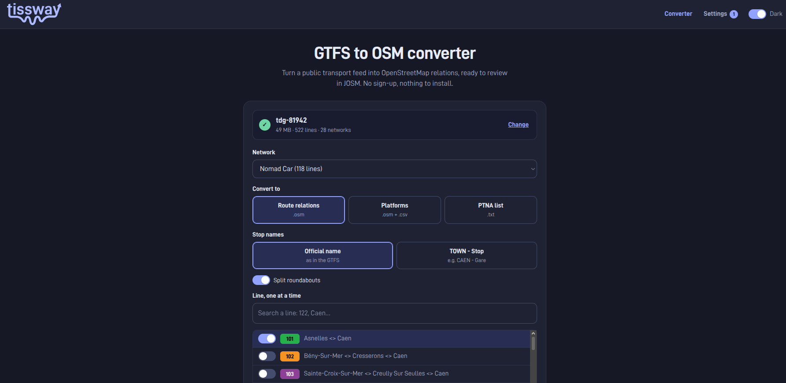
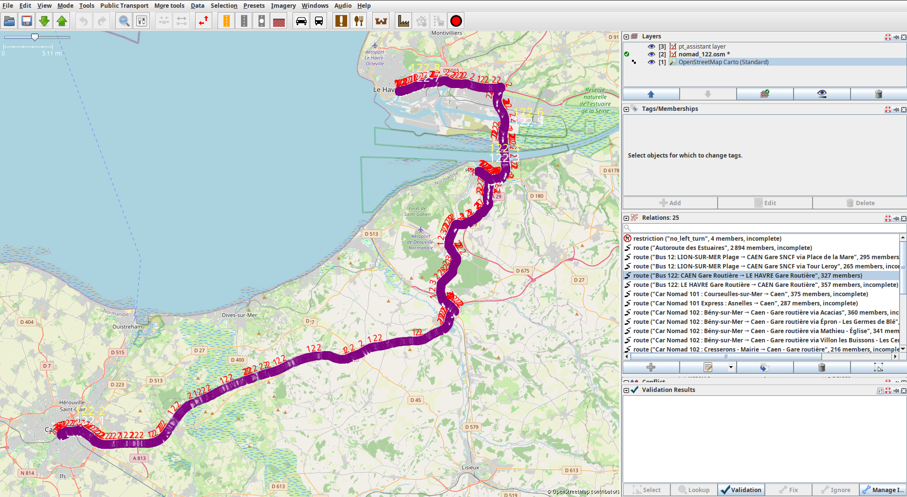

<p align="center">
  
</p>

# tissway

Generates OpenStreetMap public transport relations (PTv2) from any GTFS feed, in the browser: one `route` relation per
variant, a `route_master` per line, stop_positions on the road, platforms beside it and the ways map-matched with
[Valhalla](https://github.com/valhalla/valhalla). Lines already in OSM are updated in place rather than duplicated.
Everything goes into a single `.osm` file that you review in JOSM and then upload.

**Use it online: <https://tes-maker.github.io/TissWay/>**

It is a static site in plain JavaScript: no server, no dependency, no build step.

```bash
cd web
npm start   # http://localhost:8000
npm test    # no install needed, Node >= 20
```

To use it: enter a Mobility Database feed id (or choose a GTFS `.zip`), pick a network and a line, download the `.osm`.
Services, debugging, settings and the map of the code are in [web/README.md](web/README.md).

Works with any GTFS feed that follows the reference, with or without `agency.txt`, `shapes.txt`, `direction_id`,
`stop_code`, `parent_station`…, with basic or extended route types, in right-hand or left-hand traffic. Network
tags, tagging conventions, towns and driving side are found online, with nothing to configure.





## How it works

### Variants and map-matching

For each line and direction, every distinct stop sequence becomes a variant (most frequent first). A
sequence that appears as a block inside a longer one of the same direction is left out. The variant is
matched on OSM with Valhalla:

- from its GTFS shape when it has one;
- by routing through its stops when the shape is missing, cannot be followed, or leaves more than
  `max_far_stops` of the stops away from the matched path (straight-line or misplaced shapes).

The Activity log says which variants were routed through their stops.

### stop_positions

Each stop gets a stop_position on the travelled way, in front of the existing OSM platform used (GTFS
coordinates are often tens of metres off), else at the projection of the GTFS stop:

- in front of an existing OSM platform, the existing stop_position nearest to that platform is reused
  (within `stop_position_reuse_m` of its projection on the way), unless it is clearly closer to the
  platform of the stop across the road;
- otherwise an existing stop_position is reused if it is within `stop_position_reuse_m` of the projection;
- **unless it belongs to the stop across the road.** On a two-way road drawn as a single way, the
  stop_position of the opposite stop is often within reach. If it is closer to the projection of a stop
  of the same name (or the opposite platform) across the road, it is left to that stop and a new
  stop_position is created closer on the way, in front of our stop. Otherwise both directions would stop
  at the same spot;
- stops facing each other (projections within `stop_position_shared_m`) share one stop_position, and
  same-name stops on the same kerb are treated as one platform (aggregated feeds list the same platform
  under several networks);
- new stop_positions only carry `public_transport=stop_position`, `bus=yes` (or `trolleybus=yes`), `name`
  and, on a two-way way, `direction=forward|backward` (direction of travel relative to the way, removed
  when the stop_position is shared by both directions). They are shared by every route on that way,
  whatever its network. An existing stop_position keeps its tags (`direction`…): only the missing ones are added, except `name`, replaced by the GTFS
  name like on the platform.

### Correcting a whole network

At the bottom of Settings, once a feed is loaded, **Correct a whole network** puts what is already mapped in OSM for a network in the form of this site, after a warning. It only gives a file to review in JOSM,
and reads the stops and relations from OSM, the GTFS giving the networks and their area.

- **Stops** of its route relations: `name` without the town, `official_name` with it, punctuation, no `bus=yes` on platforms, a missing `public_transport=platform`, or `highway` on a line on the road, GTFS ids and
  numbered network tags tidied. Opposite stops of one name (within 200 m) get the same `official_name`. A stop_position only gets `name`.
- **Route and route_master relations**: `name`, `from`, `to`, `via`. The start of a name stays as it is (`Car Nomad 224:`), unless it was changed in Settings; stops told apart in a title stay.
- **Never changed**: ways, members, refs, positions. What is already right stays out of the file, so that it can be run again.

It is a mass edit: follow the [Automated Edits code of conduct](https://wiki.openstreetmap.org/wiki/Automated_Edits_code_of_conduct) before uploading the file.

### GTFS ids repeating their prefix

Some OSM objects carry ids such as `gtfs:shape_id:FR-NOR-Atoumod=NOMAD:NOMAD:2686$1072220$1618`, while the feed says `NOMAD:2686$1072220$1618`. The first part, when repeated at
the start of a `gtfs:shape_id`, `gtfs:trip_id`, `gtfs:route_id` or `gtfs:stop_id`, is corrected as soon as OSM is read, so these objects are recognised by their id. Those of the
lines converted go in the file corrected, even a relation of the line that no variant uses. An id the feed itself writes that way stays as the feed says.

### Ends of a line

- A stop_position of the first or last stop is looked for within `terminus_m` (80 m, set apart from the other distances), also on the road just beyond the trace.
  Beyond the usual reach, it must have the name of the stop or none, and be closer to this stop than to the next one. Otherwise a new one is created.
- The trace stops exactly at these stop_positions: ways before the first or after the last are left out, and a way partly travelled is cut there.
- A relation with nothing left to do keeps its trace as it is: same ways, none split for it, same stop_positions and platforms. It needs a stop_position and a
  platform for each GTFS stop, in order, each platform being one of the stop's and on the kerb side, and a trace ending exactly at its first and last
  stop_positions. Its tags are still completed. A way another line must split is still replaced by its parts.

### Platforms

- The platform is picked on the kerb side of the way in the direction of travel. Prefer the OSM platform
  already carrying the `stop_id`, else the nearest candidate. Without a candidate, a platform is created
  at the GTFS position.
- The side of an OSM platform is judged on the segment of the road next to it, not on the prolongation
  of the segment of the stop (bends). A lay-by the route passes through (an unnamed or `service` way
  between two ways of the same road) does not count, unless the vehicle stops in it. The side of a GTFS
  stop is judged on the segment of the stop, or on the road when the stop falls on a leg of a lay-by
  entering or leaving the road.
- When the GTFS attaches a route to the stop across the road (a common error), the other platform of the
  same stop is used instead: same `parent_station`, or same stop code apart from a trailing letter
  (`12A`/`12B`) and served by the same agency, or simply very close. The stop_position then goes in
  front of that platform.
- A `stop_id` is set on a single OSM platform, even when the GTFS has one stop for both directions. That
  is the platform already carrying it, else the nearest one. The other one only gets `name` and
  `network`.
- Tags of another network are never overwritten: the value goes to `network:2`, `ref:2`… Survey tags
  (`wheelchair`, `highway`…) are only added when missing.

### Existing relations

A line already mapped in OSM is updated, not duplicated:

- **Candidates** are the existing route relations of the same mode that carry the GTFS `route_id`
  (`gtfs:route_id*`), or have the same `ref` and the same `network` (or none).
- **Pairing.** Each generated variant is paired with its most similar candidate, one to one, best pairs
  first. The similarity is 1 when the relation carries the same sample trip or shape. Otherwise it weighs
  the shared platforms at 70 % and the shared ways at 30 %, and it is 0 when the shared members come in
  reverse order (the other direction). Pairs below `existing_min_similarity` are not made.
- **Update.** A paired relation keeps its id, history and the tags the tool does not manage (`operator`,
  `wikidata`, `interval`, `note`…). Its members are replaced, the generated tags are written over its
  own, and stale GTFS references (old shape, old sample trip) are removed.
- **route_master.** The existing route_master is the one holding the paired relations, else one with the
  same mode, `ref` and `network`. It keeps its other members and gets the generated relations.
- **Nothing is deleted.** Existing relations of the line left unpaired (obsolete variants) are reported
  for review in JOSM. The same line found under another `network` is reported too, but never updated.

### Split ways

A relation must only contain what the vehicle travels. Ways are split where a line enters or leaves them
at an inner node:

- a street where a line turns halfway;
- a terminus at a stop_position in the middle of a way;
- each entry and exit of a single-way roundabout.

The cuts of every line of the file are pooled, and the longest part keeps the original id and history.
Each relation containing a split way gets the parts instead. Route relations (ours and the existing ones:
other lines, cycle routes…) get only the parts they travel, deduced from their neighbouring ways, so no
dead-end part is left behind. Other relations (street, multipolygon…) get every part. Ways passing twice
through the same node are not split, because the cut position is ambiguous.

With the "Split roundabouts" setting off, roundabouts (`junction=roundabout` /
`circular`) are left whole: the relations contain the full roundabout way, as many mappers prefer.

### Names

Titles are written automatically: routes `Bus <ref>: VILLE Arret → VILLE Arret`, route masters `Bus <ref>: VILLE Arret ↔ VILLE Arret` (the two termini most
trips use); the prefix follows the mode (`Coach`, `Trolleybus`…) and can be changed for each mode on the Settings page (`Car Nomad 12: …`). The town comes from Nominatim, in capitals and without accents, and a
town the stop name says already is moved first, never written twice. Variants sharing their termini read `A → X → Y → B`, and get `via=X;Y`.

On a stop shared by several networks, the first in priority holds `ref` and the others `ref:<network>`. Before the download, a window corrects the refs found in the
place of another network, lists what is left to check and lets you order the networks; the order is kept in the `stop_owners` setting. It also proposes the refs the GTFS shows to be obsolete,
removed only when you ask, and lets you remove any ref of the platforms of the file by hand.

Stops are named without their town, which goes in `official_name` on platforms: `name=Charlotte Corday`, `official_name=MONDEVILLE - Charlotte Corday`. A town already in a GTFS or OSM name is taken out. Stop_positions and `from`/`to` use the same `name`.

## Tags written

They follow the OSM wiki's [Public transport](https://wiki.openstreetmap.org/wiki/Public_transport) page and PTNA's checks.

- **route**: `type=route`, `route=<mode>`, `ref`, `name`, `from`, `to`, `via` and `roundtrip=yes` when needed, `duration`,
  `public_transport:version=2`, the network tags, `colour`/`colour:text` (from Settings, else from the GTFS), `gtfs:route_id`, `gtfs:trip_id:sample`,
  `gtfs:shape_id` (when matched from the shape). Every `gtfs:*` key carries the `:<feed>` suffix when a feed code is known.
- **route_master**: `type=route_master`, `route_master=<mode>`, `ref`, `name`, network, colours, `gtfs:route_id`.
- **platform**: `public_transport=platform`, `highway=bus_stop` on a node (`highway=platform` on a way), `trolleybus=yes` or `coach=yes` for these lines,
  no `bus=yes` (an existing one is removed, unless the platform also serves another mode),
  `name`, network, `gtfs:stop_id`, `gtfs:stop_name`, `gtfs:stop_code` (only when no ref holds that code), `ref` (stop_code, or the code of a NeTEx-style stop_id when OSM
  platforms already follow this), `local_ref` (platform_code), `wheelchair`. An existing `route_ref` gets the line.
- **stop_position**: `public_transport=stop_position`, `bus=yes` (or `trolleybus=yes`), `name`, `direction=forward|backward` on a two-way
  way (not at its ends; removed if served both ways). An existing stop_position keeps its tags: only the missing ones are added, except
  `name`, the same as the platform's.

The network tags are `network`, `network:wikidata` and `network:wikipedia`, found in the existing OSM relations of the lines, else on
Wikidata when a single entry is confirmed. On a platform shared with another network, they get the same number as `network`
(`network:2`, `network:wikidata:2`…). `ref` is the one of the network owning the stop, the others use `ref:<network>` (`ref:Nomad`).

`operator` only comes from relations of the line already in OSM: the agency of a GTFS is often not the real operator (often a
subcontractor). Add it in JOSM if you know it.

## Review in JOSM

1. Open the downloaded `.osm` file with the **PT Assistant** plugin and download the data around the lines.
2. Go through what the Activity log reported:
   - gaps between ways;
   - stop_positions far from their stop;
   - platforms left across the road;
   - `stop_id`s already on another platform;
   - variants routed through their stops;
   - existing relations left unpaired or found under another network.
3. Fix what PT Assistant flags, add `operator` if known, validate and upload.

When an error comes back from the review, add a test case for it in `web/test/`.

## License

tissway is free software under the [MIT License](LICENSE): anyone may use, copy, modify and redistribute
it, for OpenStreetMap or anything else.

The data you upload to OpenStreetMap with it falls under the
[ODbL](https://www.openstreetmap.org/copyright), like all OSM data. Before importing anything, check that
the license of the GTFS feed allows it (see the
[import guidelines](https://wiki.openstreetmap.org/wiki/Import/Guidelines)), and follow the community
rules on [automated edits](https://wiki.openstreetmap.org/wiki/Automated_Edits_code_of_conduct): every
generated file is meant to be reviewed in JOSM before upload.
